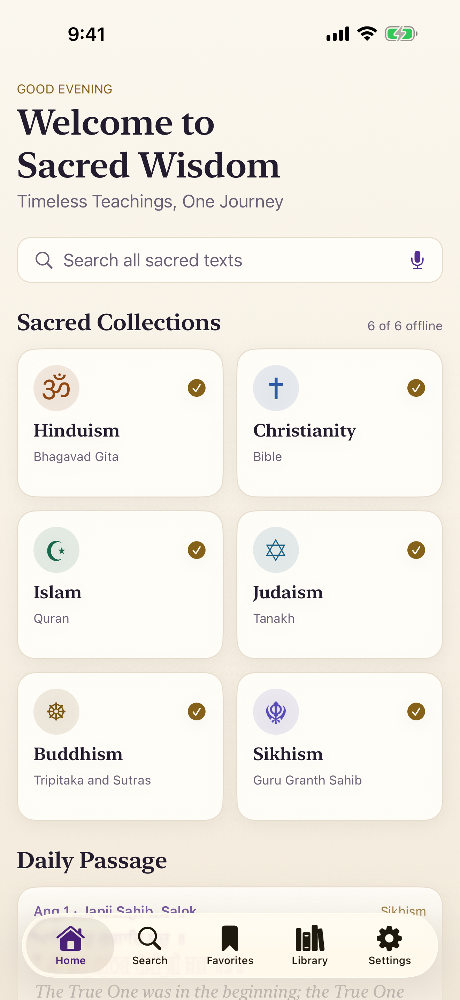
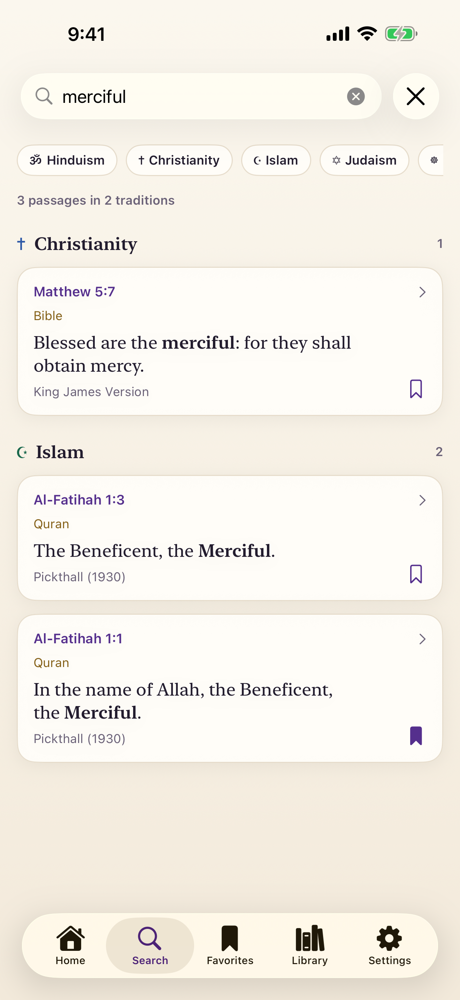
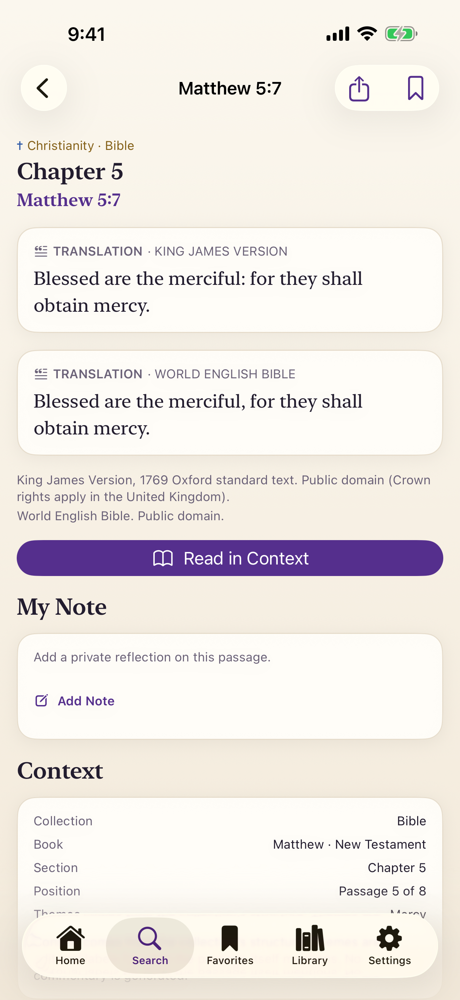
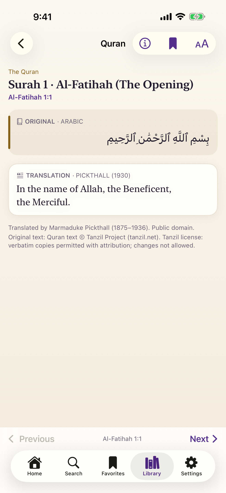
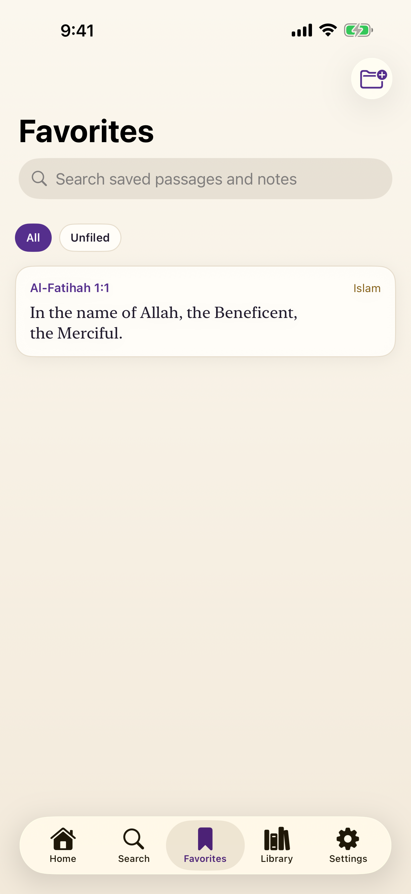
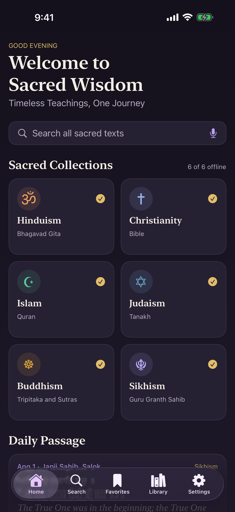
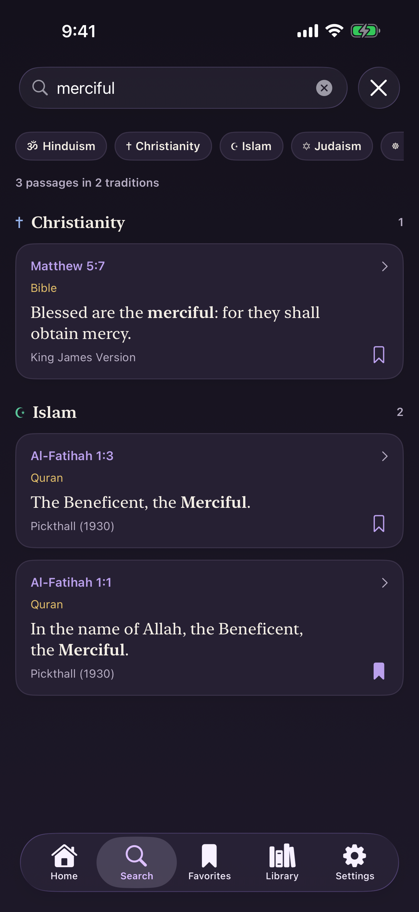
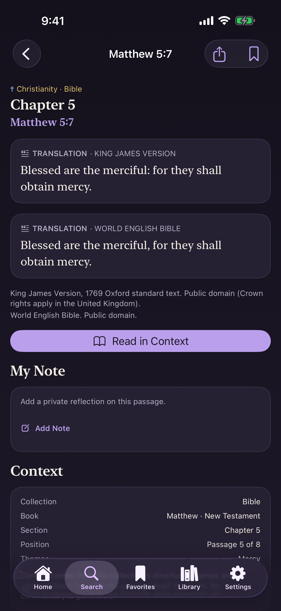
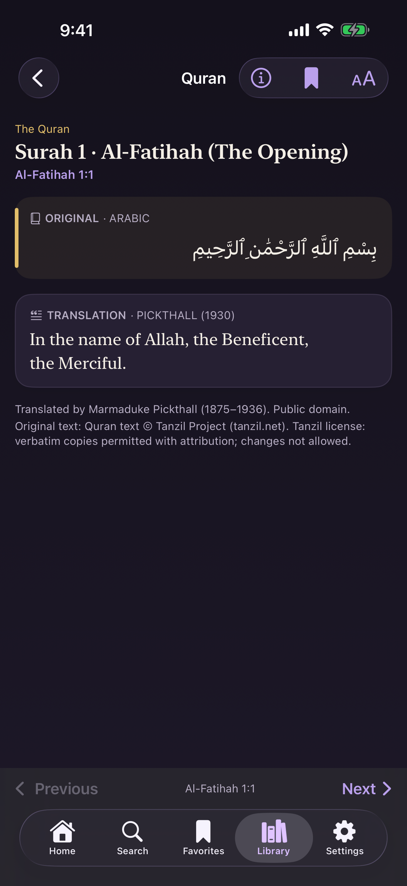
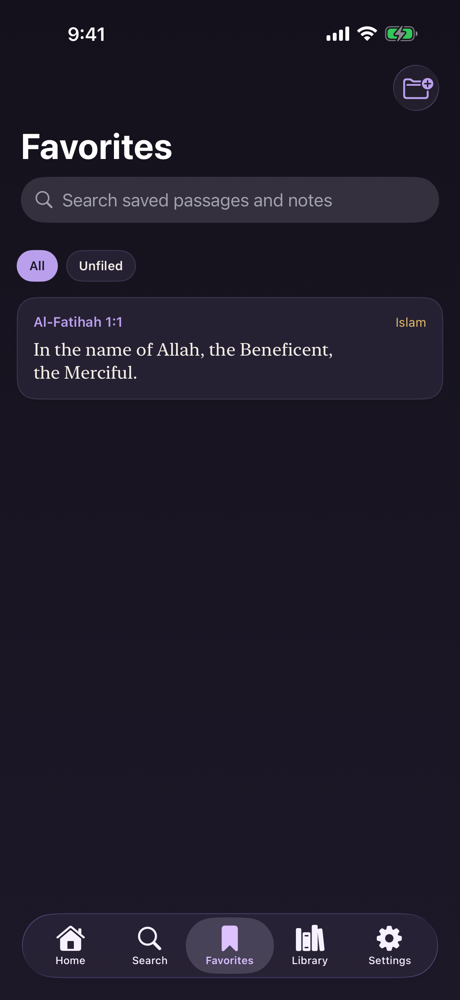

# Sacred Wisdom

A native iOS app for reading, searching and reflecting on scripture from six traditions — Hinduism, Christianity, Judaism, Islam, Buddhism and Sikhism. It is offline-first, keeps scripture in its original script beside translations, and attributes every source and license.

<p align="center">
  
  
  
  
  
</p>
<p align="center">
  
  
  
  
  
</p>

## Features

- **Library and reader** for each tradition, with original-language text (Sanskrit, Hebrew, Arabic, Pali, Gurmukhi), translations, right-to-left support and adjustable text size.
- **Universal search** across all traditions using SQLite FTS5, with theme tagging and voice search (on-device speech recognition only).
- **Verse details** with related passages, sharing and source attribution.
- **Favorites, collections and reading history**, stored locally with SwiftData.
- **Ask a question:** answers are built from retrieved passages. Explanations come from Apple's on-device Foundation Models (iOS 26+) and are validated against the passages they cite. With no model available, the app shows the passages alone.
- **Siri and Shortcuts** through App Intents: daily passage, topic search, open a passage.
- **Offline content downloads** from a configurable manifest URL, verified with SHA-256 and resumable.
- **Accessibility:** Dynamic Type up to accessibility sizes, VoiceOver labels, contrast-checked colors, and automated accessibility audits in UI tests.
- **Privacy:** no accounts, analytics or tracking. The only network request downloads content packages.

## Architecture

Swift 6 with strict concurrency, SwiftUI, MVVM plus Clean Architecture (Features → Domain use cases → repository protocols ← Data), and dependency injection through a single composition root. Scripture is never in Swift source: it ships as generated JSON content packages that are imported into SQLite at launch. See [`docs/ARCHITECTURE.md`](docs/ARCHITECTURE.md) for the decisions behind each phase.

```
SacredWisdom/
  App/          composition root, coordinator, preferences
  AppIntents/   Siri & Shortcuts
  Core/         design system, utilities
  Domain/       entities, repository protocols, use cases
  Data/         SQLite + FTS5, SwiftData, downloads
  Features/     SwiftUI views and view models
  Services/     search, speech, AI, sharing
  Resources/    content package, assets, privacy manifest
  Tests/        unit, integration, UI, performance
tools/          content and App Store asset generators
content/        downloadable content packages + manifest
```

## Building

Requirements: Xcode 26+, iOS 17.0 deployment target, [XcodeGen](https://github.com/yonaskolb/XcodeGen).

```sh
xcodegen generate
open SacredWisdom.xcodeproj
```

Run the tests:

```sh
xcodebuild test -project SacredWisdom.xcodeproj -scheme SacredWisdom \
  -destination 'platform=iOS Simulator,name=iPhone 17 Pro'
```

The suite has 247 Swift Testing tests in 56 suites, plus 30 XCTest UI and performance cases.

To enable content downloads, set the `CONTENT_MANIFEST_URL` build setting to an HTTPS URL that serves `content/packages/manifest.json`.

## Content and licenses

Scripture text is generated by `tools/content/build_sample_library.py` and `tools/content/build_download_packages.py`, which download each source and extract the text verbatim. The app lists every source and license under **Settings → Sources & Licenses**. Some licenses (Tanzil, SuttaCentral, BaniDB, and the King James Version's UK Crown rights) still need confirming before distribution; see [`AppStore/metadata.md`](AppStore/metadata.md).
